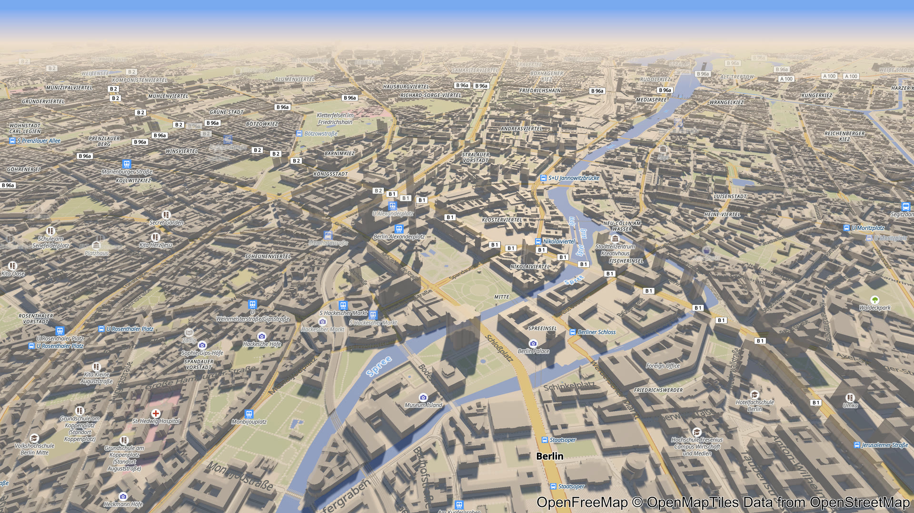

# unity-map-renderer preview

The public preview of **unity-map-renderer**, a Unity-native (DOTS: Burst and the job system) renderer for
MapLibre-style vector maps. It reads MapLibre style JSON and Mapbox Vector Tiles, and draws fills, lines, labels
and 3D buildings on a globe or a Web Mercator plane, with sky, sun and shadows.

**Live site: https://vladyslavsan.github.io/unity-map-renderer-preview/**

https://github.com/user-attachments/assets/5bd544eb-3257-4847-91e3-380662c364e5

This repository holds the built web players and the map styles. The renderer's source code is private.

## What is here

- **Web players**, served by GitHub Pages:
  - [`play/`](https://vladyslavsan.github.io/unity-map-renderer-preview/play/): the renderer with the Liberty style.
  - [`flythrough/`](https://vladyslavsan.github.io/unity-map-renderer-preview/flythrough/): a camera tour of
    Berlin that starts on its own.
  - They need a browser with WebGPU: a current Chrome or Edge on a desktop computer is the safe choice.
  - Each player has a `version.json` with the version and the commit it was built from. The players are published
    by a script in the private repository.
  - `vendor/coi-serviceworker/` is the service worker that makes the threaded player work on Pages (MIT).
- **Map styles**, served as raw files:
  - Liberty: `https://raw.githubusercontent.com/VladyslavSan/unity-map-renderer-preview/main/styles/liberty.json`
  - Liberty Night: `https://raw.githubusercontent.com/VladyslavSan/unity-map-renderer-preview/main/styles/liberty-night.json`
- **The landing page**: `index.html`, with `og.png`, `hero.png` and the icons.
- `flythrough.jpg`: the still at the top of this README.
- `index.html` carries `tdm-reservation` and `tdm-policy` meta tags. `robots.txt` and `/.well-known/tdmrep.json`
  are read only at the host root, so they live in the
  [VladyslavSan.github.io](https://github.com/VladyslavSan/VladyslavSan.github.io) repository.

## Licence

The renderer is **source-available, not open source**.

- `LICENSE.md`: the players are licensed under the PolyForm Noncommercial License 1.0.0. Commercial use needs a
  separate commercial licence from the copyright holder.
- `NOTICE.md`: text and data mining rights are reserved, and training a machine-learning model for a commercial
  entity is commercial use.
- `THIRD-PARTY-NOTICES.txt`: the third-party components in the players.

Commercial licensing: [vladyslav.odobesku@gmail.com](mailto:vladyslav.odobesku@gmail.com)

## Styles and attribution

`styles/liberty.json` is the [OpenFreeMap](https://openfreemap.org/) "Liberty" style, pretty-printed and
otherwise unmodified. `styles/liberty-night.json` is a night variant made for unity-map-renderer: Liberty with
darkened colours plus top-level `light` and `sky` blocks.

- OpenFreeMap project: MIT, Copyright (c) 2023 Zsolt Ero
  ([licence](https://github.com/hyperknot/openfreemap/blob/main/LICENSE.md)).
- The Liberty design (a fork of OSM Liberty, from OSM Bright / Mapbox Open Styles) and the OpenMapTiles
  schema: BSD-3-Clause (code) and CC BY 4.0 (design).
- Both styles load tiles, hillshade, sprites and glyphs from live OpenFreeMap endpoints.

Any map drawn with these styles must display:

> OpenFreeMap © OpenMapTiles Data from OpenStreetMap

Map data © [OpenStreetMap contributors](https://www.openstreetmap.org/copyright). Hillshade: Natural Earth
(public domain).
